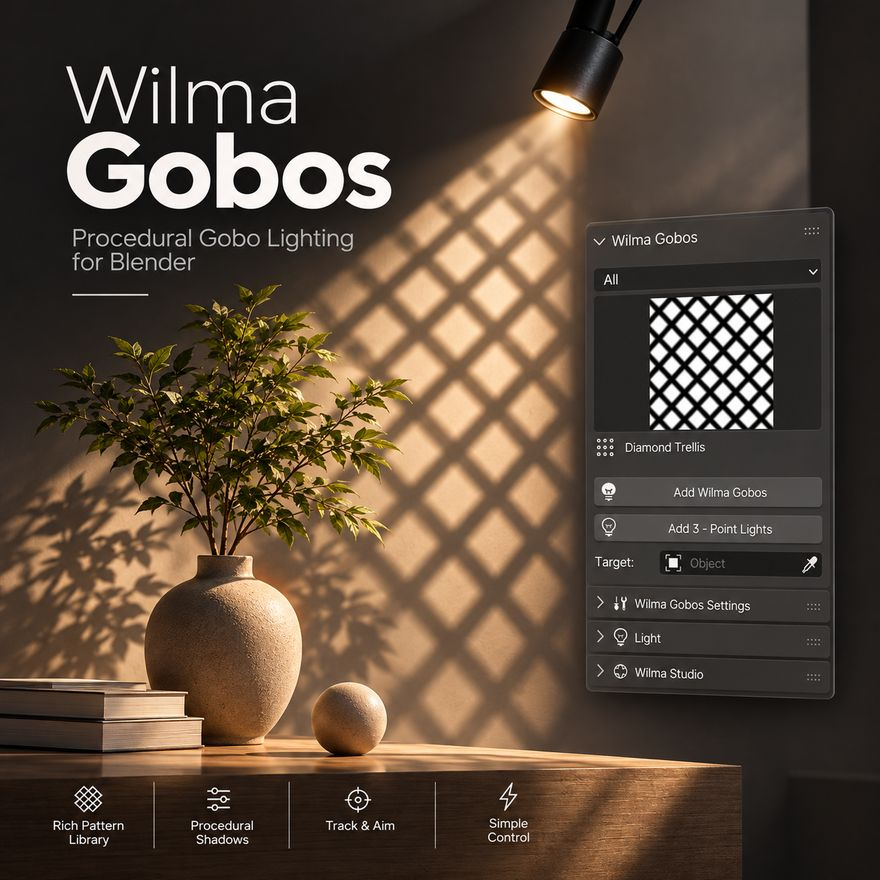

  

<h1 align="center">Wilma Gobos</h1>

  <b>Sculpted light and shadows for Blender 5.2+</b> 
  Procedural gobo spot lights &mdash; every pattern is built from shader nodes, so there are no image files to manage and every look can be tuned.

  <a href="https://wilmastudio.co">wilmastudio.co</a>
  &nbsp;&middot;&nbsp;
  Version 1.4.2
  &nbsp;&middot;&nbsp;
  Blender 5.2+
  &nbsp;&middot;&nbsp;
  GPL-3.0-or-later

---

## What it is

**Wilma Gobos** turns any spot light into a pattern projector. A hidden
"gobo" plane is parented in front of the lamp and driven by plain Blender
drivers (no Python in the expressions, so files work even without the add-on
installed). The plane is invisible to the camera, to diffuse, to glossy and
to transmission &mdash; it only casts shadows, through a material whose
transparency is the pattern. This works in both **Cycles** and **EEVEE**.
Coloured patterns (stained glass) tint the light in Cycles.

Instead of shipping image files, every gobo is generated procedurally from
shader node groups, so you can resize, reshape, recolour and reseed each
pattern live in the panel. You also get a **Custom Image** entry that lets
you load your own black-and-white image (white lets light through, black
blocks it).

> Open the 3D Viewport sidebar (**N**) and look for the **Wilma Gobos** tab.

---

## Features

- **41 procedural patterns** and **128 ready-made presets**, organised into
  six categories (Frames, Meshwork, Botanical, Atmosphere, Graphic, and
  Lines &amp; Shapes) plus an always-first **Custom Image** slot.
- **Thumbnail browser** &mdash; pick a look by eye, then press *Add Wilma Gobos*.
- **Clean scene organisation** &mdash; every add-on light is named `W_Gobo_01`,
  `W_Gobo_02`, ... with its pattern plane `W_Pattern_01`, `W_Pattern_02`, ...
  and everything lives in one shared **Wilma Gobos** collection.
- **Quick 3-Point Lighting** &mdash; one button builds a Key / Fill / Rim trio
  of area lights around the selected object, each one tracking it.
- **Live target tracking** &mdash; point a light at any object and it follows
  it through a *Track To* constraint visible in the Constraints tab.
- **Per-light settings** that are direct views onto the rig (custom
  properties and material nodes), so there is nothing to keep in sync.
- **More Settings** collapsible section on every pattern: *Scale*, *Flip* and
  *Invert* &mdash; works for the Custom Image too.
- **Haze** toggle fills the world with a thin volume so the light draws
  visible beams (slower to render).
- **Make Unique** breaks the link when a pattern is shared between lights
  (for example after duplicating).
- **Random Seed** button on every pattern that has a Seed input, for endless
  variations.
- Files saved with older add-on versions are **upgraded automatically** on
  load, keeping your values.

---

## Install

1. Download the latest `Wilma_Gobos_Blender5.2_v1.4.2.zip` from the
   [Releases](../../releases) page.
2. In Blender 5.2: **Preferences &rsaquo; Get Extensions &rsaquo; drop-down
   menu (top right) &rsaquo; Install from Disk**, then choose the ZIP.
3. Enable **Wilma Gobos**.

The add-on panel appears in the 3D Viewport sidebar (**N**) under the
**Wilma Gobos** tab.

---

## Usage

1. Open the sidebar (**N**) &rsaquo; **Wilma Gobos**.
2. Pick a category and a preset (or **Custom Image** and your own file),
   then press **Add Wilma Gobos**. Optionally set a **Target** object first
   so the new light follows it. Lights land in the shared **Wilma Gobos**
   collection as `W_Gobo_01`, `W_Gobo_02`, ... with their hidden pattern
   planes `W_Pattern_01`, `W_Pattern_02`, ...
3. Tune the pattern in **Wilma Gobos Settings** and the lamp itself in
   **Light** (color/temperature, power, exposure, radius, soft falloff,
   custom distance, beam shape).
4. The **Gobo** toggle turns the pattern on/off without deleting anything.

### Quick 3-Point Lighting

Select the object you want to light and press **Add 3-Point Lights**. You
get three area lights &mdash; **Key**, **Fill** and **Rim** &mdash; placed
around the object, each following it with a *Track To* constraint. All
three lamps use a gentle fixed power of **10&nbsp;W**; the balance between
them comes from **exposure**: Key **+5**, Fill **+3** and Rim **+2** stops,
so the setup never blows out the subject. Light sizes still adapt to the
object's bounding box. Duplicate the setup for other subjects; Blender
suffixes the names automatically.

### Tips

- **Focus Distance** (under the light's custom properties) controls how far
  the pattern sits from the lamp. Further away gives sharper shadows.
- **Spot Size** on the lamp changes the cone; the plane auto-fits so there
  is no light leak.
- For softer projector shadows, raise the lamp **Radius** a little.
- Use **Haze** only when you want visible volumetric beams &mdash; it costs
  render time.
- Duplicated lights share their pattern material until you press
  **Make Unique**.

---

## Patterns and presets

There are 41 procedural patterns, each exposed through one or more presets
(128 in total). A preset is a pattern plus a saved set of values.

| Category | What you get |
| --- | --- |
| **Frames** | Window panes, louvers, rosettes, lancet arches, broken glass |
| **Meshwork** | Lattices, grilles, hex honeycomb, arabesque screens, wrought iron, ducts, wire, crackle |
| **Botanical** | Leaves, ferns, fan palms, reeds, bamboo, limbs/twigs, needles, vines, cacti, dappled sun |
| **Atmosphere** | Cobwebs, orb webs, sheer/lace curtains, water ripples, mottle breakup |
| **Graphic** | Wave stripes, halftone dots, sunburst rays, rings, spirals, weaves, brickwork, rain, stars, cloud streaks |
| **Lines &amp; Shapes** | Thin light slits, soft shapes, gradients, line grids, crackle lines, dappled light |
| **Custom Image** | Your own black-and-white image (white = light, black = blocked) |

Every procedural pattern exposes its own inputs in the panel (cell count,
bar width, leaf density, wave frequency, fade, bend, twist and so on), and
each one with randomness has a **Seed** you can re-roll.

---

## How it works

A spot lamp gets a small hidden plane parented in front of it, placed along
the lamp's -Z axis by Blender drivers that read the `wg_distance` custom
property and the spot cone angle. The plane uses a transparent BSDF whose
colour comes from the pattern node group, so the plane only modulates
shadow transparency. Because the drivers are plain expressions, a file
saved with Wilma Gobos renders correctly on any machine &mdash; the add-on
is only needed to add or edit the lights.

Node groups are versioned (`wg_version`) and rebuilt automatically when an
older file is opened, preserving the input values you saved.

---

## Changelog

### 1.4.2
- The preset list is tidy again: presets are grouped by category (Frames,
  Meshwork, Botanical, Atmosphere, Graphic, Lines & Shapes), each folder
  kept together in the browser. **Custom Image** still leads the list.
  The category list is capped at ten folders.
- New look for the repository page.

### 1.4.1
- Three-point lighting rebalanced: all three lamps (Key, Fill, Rim) use a
  fixed **10 W** power and the intensity is balanced through **exposure**
  instead &mdash; Key +5, Fill +3, Rim +2 stops. The rig no longer blows out
  the subject regardless of its size.

### 1.4.0
- New **Add 3-Point Lights** button under *Add Wilma Gobos*: builds a quick
  three-point setup around the selected object with three area lights named
  **Key**, **Fill** and **Rim**, each tracking the object.
- Lights created by the add-on are now named `W_Gobo_01`, `W_Gobo_02`, ...
  and their pattern planes `W_Pattern_01`, `W_Pattern_02`, ...
- All add-on lights live in one shared **Wilma Gobos** collection, created
  and linked to the scene automatically.

### 1.3.2
- The preset browser used to show patterns in a varied, organic layout;
  since 1.4.2 it is grouped by category again (see the 1.4.2 entry).
- Switching category now keeps your current preset when it exists in the
  new category (previously it reset every time).
- Internal clean-ups and a wider static test pass; no workflow changes.

### 1.3.1
- New collapsible **More Settings** section under every pattern: *Scale*,
  *Flip* and *Invert*. Works for the Custom Image too.

### 1.3.0
- Target now follows live through a *Track To* constraint named
  "Wilma Target".
- 6 new procedural patterns and 38 new presets (Light Slit, Soft Shape,
  Light Gradient, Line Grid, Crackle Lines, Dappled Light).
- New "Lines & Shapes" category.

### 1.2.0
- New **Custom Image** entry, always first in the browser.
- New **Target** field under the Add button.

### 1.1.0
- Sidebar tab and main panel named "Wilma Gobos".
- Spot lights only.
- 10 new procedural patterns and 32 new presets in a new "Graphic" category.

---

## Credits and license

This build is derived from the **Open Shadow 0.1.0** source package. The
original project license is retained in [`LICENSE`](LICENSE) and this build
continues under **GPL-3.0-or-later**.

&copy; Wilma Studio &mdash; https://wilmastudio.co
